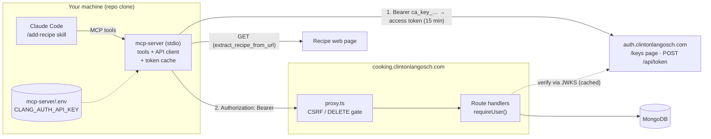
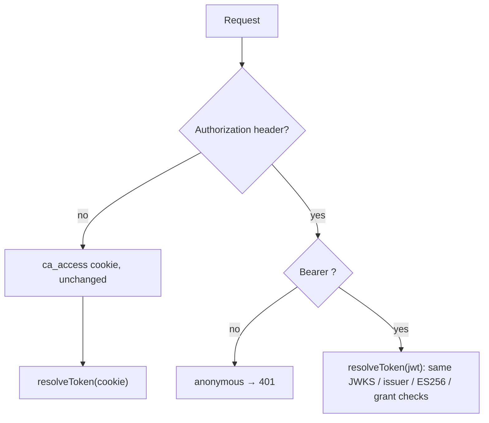

# Add recipes from Claude Code: Design

Status: Approved (revised 2026-11-22: keys move to clang-auth)
Date: 2026-11-22
Branch: feat/recipe-mcp-skill
Requirements: [requirements.md](requirements.md)
Depends on: [service-clang-auth-claude#4](https://github.com/roadlittledawn/service-clang-auth-claude/issues/4), which adds per-user API keys and `POST /api/token` (in progress, expected within a day)

## Context

The app is Next.js (App Router) on Vercel, with MongoDB through Mongoose. Auth is clang-auth only: route handlers call `requireUser()` / `requireAdmin()`, which verify the `ca_access` cookie against clang-auth's JWKS. `src/proxy.ts` refuses cross-origin API writes, because the cookie is shared across `*.clintonlangosch.com`.

The API already has everything needed to create a recipe: `POST /api/recipes`, and `GET`/`POST /api/ingredients`. All of it is cookie-only, though.

**clang-auth #4** adds:

- per-user, per-app API keys (`ca_key_…`), managed on `https://auth.clintonlangosch.com/keys`
- `POST /api/token` with `Authorization: Bearer ca_key_…`, which returns `{ token, token_type, expires_in: 900 }`. The token is a normal ES256 access token scoped to the key's app, with `amr: ["api_key"]`. The exchange fails if the key is revoked or expired, the user is disabled, or the grant is gone.

So the app stores no keys. It only has to accept a Bearer access token, which is item 6 of #4 and an app-side change.

## Goals and non-goals

**Goals:** Bearer access-token auth with key-token restrictions (R1–R4). A public tag list and an exact ingredient lookup (R5, R6). A local MCP server that does the key exchange and provides compact, name-based tools (R7–R12, N5). An `/add-recipe` skill that drafts, confirms and creates (R13–R21).

**Non-goals:** key management in the app. Also everything listed under Out of scope in the requirements: no in-app AI, no remote MCP, no images, no deletes or admin through a key.

## Architecture

There are three pieces:

1. **App: Bearer auth.** A second token source inside the existing auth helpers, with the same verification as the cookie, plus `amr`-based restrictions.
2. **`mcp-server/`.** A thin typed layer over the API. It does the key exchange and token caching, resolves ingredient names to ids, and extracts recipe data from web pages. It makes no decisions of its own.
3. **`.claude/skills/add-recipe/`.** The workflow and judgment: extracting, matching, drafting, confirming.

**Data model: no changes.** There are no new collections, because keys live in clang-auth.

## Authentication changes

### Where the token comes from

`getAuthState()` today reads only the `ca_access` cookie. It changes to:

- **A Bearer header always wins, and a bad Bearer token never falls back to the cookie** (R1, N1).
- **Same verification, same states.** `anonymous` gives `401`, `forbidden` (no `cooking` grant) gives `403`, and `ok` continues (R2). Route handlers already return JSON `401`s, so there's no redirect.
- **No new identity fields.** A key token's `apps.cooking` holds the roles chosen for that key, so `roleFromGrant()` works unchanged.

### Key-token restrictions (R3)

- **Role:** decided in [#4](https://github.com/roadlittledawn/service-clang-auth-claude/issues/4#issuecomment-7083618406). Each key carries a subset of the user's roles, ticked on `/keys` with none by default, and the token's roles are the key's roles intersected with the user's current grant. The app trusts them like any token's roles. An admin's key is a regular user unless the admin deliberately ticks `admin`, and demoting the user demotes their keys.
- **No deletes:** `requireUser()` can't see the HTTP method, so the proxy enforces this. The proxy can only see that an `Authorization` header is present: it can't verify the token without the JWKS round trip it avoids on API paths. So the rule is **any `DELETE` with an `Authorization` header gets `403` "Deletes are only available in the web UI."** This app has no other Bearer clients, so that's equivalent today. If one ever appears, move the check into the handlers and base it on the token's `amr: ["api_key"]`.
- **User records:** the user is looked up and synced by `sub` exactly as on the cookie path (`findOrCreateUser`). Authorship is correct because the token's `sub` is the key owner.

### Proxy CSRF

| Request | Today | New |
|---|---|---|
| Write with no `Authorization` header | Same-origin check | Unchanged (N1) |
| Write with an `Authorization` header | Same-origin check (fails from a CLI) | **Skip the same-origin check.** Browsers don't add this header automatically, and a cross-site page that sets it triggers a CORS preflight, which the app doesn't allow. |
| `DELETE` with an `Authorization` header | n/a | `403` |

This is written as a pure function `apiWriteDecision(method, hasAuthorization, sameOrigin)`, so it can be tested.

### Revocation (R4)

There's nothing to build in the app. The MCP server must re-exchange its key every 15 minutes or less, and clang-auth refuses the exchange once the key is revoked, the grant is removed or the user is disabled. The worst case is one token lifetime. This replaces the earlier runbook (option A).

## API changes

| Endpoint | Auth | Change | Covers |
|---|---|---|---|
| `GET /api/tags` | user (cookie or Bearer) | New. `{ tags: string[] }`: the `Tag` documents plus the tags already on recipes, sorted. No counts and no `showInFilter`. | R5 |
| `GET /api/ingredients?name=<exact>` | public (as today) | New param: exact, case-insensitive match, returning 0 or 1 items. `q` search is unchanged. | R6, R10, R17 |
| `POST /api/recipes`, `PUT /api/recipes/:id`, `POST /api/ingredients` | user (cookie or Bearer) | No code change. They pick up Bearer through `requireUser()`. | R1 |
| `GET /api/recipes`, `GET /api/recipes/:id` | public | No change. | |

**Why the exact-name param:** `q` is an unanchored regex search limited to 20 results, sorted by name. For a common word like "salt" the exact match may not appear in the top 20, which would create duplicate ingredients.

Validation errors keep their current shape, `{ error, details: { field: [messages] } }`.

**User menu:** add an "API keys" link to `${AUTH_BASE_URL}/keys?app=cooking`, so the setup step is one click from the app.

## MCP server

**Layout:** an `mcp-server/` npm workspace with its own `package.json`, `tsconfig`, tests and README, built to `dist/`. The root `package.json` gains `"workspaces": ["mcp-server"]`. The root `tsconfig` and ESLint config exclude `mcp-server/`. CI builds, type-checks and tests it as a separate step (N4).

**Runtime:** the official MCP TypeScript SDK over stdio, with zod input schemas. A committed `.mcp.json` registers it as `cooking`, running `node mcp-server/dist/index.js`.

**Config:** it reads `mcp-server/.env` (gitignored, N2), with `.env.example` committed:

| Var | Default | Purpose |
|---|---|---|
| `CLANG_AUTH_API_KEY` | (required) | A `ca_key_…` key for the `cooking` app, from clang-auth `/keys`. |
| `COOKING_BASE_URL` | `https://cooking.clintonlangosch.com` | Local: `http://cooking.localtest.me:3004`. |
| `AUTH_BASE_URL` | `https://auth.clintonlangosch.com` | Local: `http://auth.localtest.me:4000`. |

**Token handling (R8):**

1. On the first API call, `POST ${AUTH_BASE_URL}/api/token` with the key.
2. Keep the token in memory until 60 seconds before `expires_in` runs out (N2).
3. If an app request gets a `401`, exchange again once and retry.
4. If the exchange returns `401 invalid_api_key`, fail with *"clang-auth rejected the API key (revoked, expired, or access removed). Create a new one at ${AUTH_BASE_URL}/keys?app=cooking and update mcp-server/.env."* (R11)

Concurrent calls share one exchange in flight rather than each starting their own.

### Tools

Each tool's description is written for the model and says when to use it. Results are compact JSON (N5).

| Tool | Input | Calls | Returns |
|---|---|---|---|
| `search_recipes` | `query`, `limit` (≤ 20, default 10) | `GET /api/recipes?q=` | `[{ id, title, author, url }]` |
| `get_recipe` | `id` | `GET /api/recipes/:id` | Every field, with `ingredients: [{ name, amount, unit }]`, plus `author`, `url` and `isMine` |
| `list_tags` | (none) | `GET /api/tags` | `string[]` |
| `search_ingredients` | `query` | `GET /api/ingredients?q=` | `[{ id, name }]` |
| `create_ingredient` | `name` | `POST /api/ingredients` | `{ id, name, created: boolean }` |
| `create_recipe` | `title`, `description?`, `servings`, `prepTime`, `cookTime` (minutes), `steps` (Markdown), `tags[]`, `ingredients: [{ name, amount, unit? }]` | Resolves names, then `POST /api/recipes` | `{ id, title, url }` (R20) |
| `update_recipe` | `id`, plus any of the `create_recipe` fields. `ingredients`, if given, replaces the whole list. | Resolves names, then `PUT /api/recipes/:id` | `{ id, title, url }` |
| `extract_recipe_from_url` | `url` | Fetches the page directly, not through the app | The normalized `schema.org/Recipe` JSON-LD, or `{ found: false }` |

`isMine` compares the recipe's author with the caller, using `GET /api/me`, called once and cached.

**Name resolution (R10, R17):** `create_recipe` and `update_recipe` look up each ingredient with `?name=` exact matching. **They never create ingredients.** If any name is unknown, the tool fails and lists every unknown name, so a new ingredient only ever comes from an explicit, confirmed `create_ingredient` call.

**Errors (R11):**
- A `400` becomes `Validation failed: prepTime: Expected number, received string`.
- A `403` becomes "not allowed (you can only edit your own recipes; deletes are web-only)".
- Network failures get a one-line message.

All errors come back as MCP tool errors (`isError`).

**`extract_recipe_from_url` (R14):**
- It handles JSON-LD that's an object, an array, or an `@graph`.
- It converts ISO-8601 durations (`PT1H15M`) to minutes, and flattens `recipeInstructions`, including `HowToSection`.
- It returns `name`, `description`, `recipeYield`, `prepTime`, `cookTime`, `totalTime`, `recipeIngredient[]`, `recipeInstructions[]` and `keywords`.

Its purpose is exact quantities at a fraction of the tokens a whole page would take. If there's no JSON-LD, the skill falls back to WebFetch.

## Skill: `/add-recipe`

This is `.claude/skills/add-recipe/SKILL.md`, committed, so Brie gets it on clone. The workflow:

1. **Get the source:** a URL, pasted text or a description. For a URL, call `extract_recipe_from_url` first and fall back to WebFetch (R13, R14).
2. **Normalize:** times in whole minutes. Servings as an integer, so "makes 24 cookies" becomes 24. Amounts as strings ("1 ½", "2–3"). A unit only when it's a measure, so "2 eggs" is amount `2`, unit `""`, name `egg`. Ingredient names lowercase and singular, with prep notes moved into the steps. Steps as a numbered Markdown list (R21).
3. **Ask** about missing required fields in one batch, and never guess silently (R15).
4. **Check for duplicates:** `search_recipes` on the main title words (R16).
5. **Match ingredients:** `search_ingredients` for each one, preferring an existing name over trivial differences (R17). Match tags against `list_tags` (R18).
6. **Show the draft:** ingredients with **new** marked, the times and servings, the tags (new ones marked), the first lines of the steps, and any possible duplicate. Then wait for confirmation and apply any edits (R19).
7. **Write:** `create_ingredient` for each confirmed new one, then `create_recipe`. Report the URL (R20).

The skill also covers "update my recipe X" by way of `search_recipes`, `get_recipe` and `update_recipe`, with the same confirm-before-write rule.

## Alternatives considered

- **App-owned API keys (the earlier version of this plan).** A key table, an account page and key endpoints in the app. Dropped once #4 moved keys into clang-auth: it was about three tasks of throwaway work, a grant check the app couldn't do, and every user would have had to create new keys later.
- **The MCP server writes to MongoDB directly.** It duplicates validation, bypasses the ownership rules, and means handing out database credentials. Rejected by dev-standards.
- **Wait for #4 before starting.** Unnecessary. Only the MCP token exchange needs #4, and it's expected within a day. Everything before it can be built and tested with locally signed tokens.
- **An in-app "import from URL or text" feature.** Deferred. See the requirements.

## Security

- **Token handling:** the app verifies Bearer tokens exactly like cookies: ES256, issuer, JWKS and grant. A Bearer header never falls back to the cookie. The MCP server keeps exchanged tokens in memory only. The key itself stays in a gitignored file (N2).
- **Blast radius of a leaked key:** limited to this app (#4 scopes the token's `apps` to `cooking`), and, unless the key was deliberately given `admin`, to regular-user actions: read, create and edit the owner's recipes, and create ingredients. It can't delete (any role), and without `admin` it can't use admin routes or edit others' recipes. The owner revokes it on clang-auth, and it stops working within 15 minutes.
- **CSRF:** unchanged for cookie requests. The bearer path is exempt, for the reasons given under Proxy CSRF.
- **Preview deployments:** a Bearer token works on previews that share the production database. That's acceptable: a token holder can do the same things on prod, and nothing about previews changes for browsers.
- **`extract_recipe_from_url`** runs locally and fetches only URLs the user gave it, so there's no SSRF exposure on the server.
- **Pre-existing issue, noted only:** the `q` searches pass user input into `$regex` unescaped. A follow-up should fix it.

## Testing

These use the existing `tsx` + `node:assert` style.

- **`scripts/test/auth.test.ts`, extended** (N3). These reuse its throwaway ES256 keypair and `setJwksForTesting`:
  - Choosing the token source, written as a pure function over the headers and cookie: Bearer wins, and a bad Bearer token doesn't fall back.
  - `resolveToken` on Bearer tokens: valid, expired, wrong issuer, no grant.
  - A key token's roles are honored as given (no roles means user). A key token scoped to another app is forbidden.
  - `apiWriteDecision`: cookie write cross-origin is 403, cookie write same-origin passes, bearer write cross-origin passes, bearer `DELETE` is 403.
- **`mcp-server` unit tests:**
  - The token cache: first call exchanges; a second call within the lifetime reuses the token; near expiry it exchanges again; a `401` triggers one exchange and a retry; concurrent calls share one exchange; an exchange `401` gives the "create a new key" message.
  - Name resolution and error formatting.
  - JSON-LD extraction fixtures.
- **Manual checks:** local first, against local clang-auth with #4, then on prod.
  - Create a key on `/keys`.
  - `curl` the token exchange, then the API with the token.
  - A Bearer `DELETE` gives 403, and an admin route with a key token gives 403.
  - A cross-origin cookie write is still 403.
  - Run `/add-recipe` end to end on a URL and on pasted text.
  - Revoke the key, and the MCP server fails with the new-key message after its token runs out.

## Rollout and rollback

- **Rollout:** the usual PRs, `feat/…` → `develop` → `main`. It needs #4 deployed to prod clang-auth before the MCP server works against prod. The app-side Bearer support can ship before then, since nothing sends Bearer tokens yet.
- **Rollback:** revert the PR. There's no data to migrate. Recipes created through the MCP server are ordinary recipes.
- **Monitoring:** this is personal scale, so there are no alerts. clang-auth logs `api_key_exchanged` and `api_key_rejected`, `/keys` shows when each key was last used, and Vercel logs show 401s and 403s on the API.

## Risks

| Risk | Impact | Likelihood | Mitigation |
|---|---|---|---|
| Adding workspaces changes how the root install behaves on Vercel or CI | Broken deploy | Medium | Task 1 does only this, verified with `npm ci`, `next build` and a Vercel preview before any MCP code. |
| #4 lands with a different contract (claim names, endpoint, how roles are scoped) | Rework in the auth and MCP client tasks | Low to medium | Task 2 follows the issue's spec and tests with locally signed tokens. Check #4's merged docs before task 4, which is the only task that calls `/api/token`. |
| A bug in the Bearer path weakens browser auth (CSRF bypass or cookie fallback) | Security regression | Low | The header decides the path. Both decisions are pure functions, tested case by case. |
| Recipe sites block plain fetches (bot protection) | URL extraction fails | Medium | The skill falls back to WebFetch, then asks the user to paste the text. |
| The model mangles quantities or invents steps | Wrong recipe saved | Medium | Prefer JSON-LD, show a confirmation draft, never fill required fields silently, and allow easy fixes with `update_recipe`. |
| Ingredient vocabulary drifts ("scallion" vs "green onion") | Duplicate ingredients | Medium | Exact-name lookup, plus the skill searching for synonyms and marking new ones before you confirm. The admin merge tool cleans up whatever slips through. |

## Build order

1. **`chore: add mcp-server npm workspace skeleton`.** Root workspaces, excludes, a hello-world stdio server, `.mcp.json`, CI. Verify the install, build and preview, and that `/mcp` connects.
2. **`feat(auth): accept Bearer access tokens`.** Token source, the proxy's CSRF and DELETE decision, plus tests (R1–R3, N1, N3).
3. **`feat(api): add tag list and exact ingredient lookup`** (R5, R6).
4. **`feat(mcp): add token exchange and read tools`.** Needs #4 running locally. Token cache, API client, errors, the read tools, the "API keys" menu link, plus tests (R4, R7–R9, R11, R12, N5).
5. **`feat(mcp): add write tools`.** Name resolution, plus tests (R9, R10, R20).
6. **`feat(mcp): add extract_recipe_from_url`**, plus tests (R14).
7. **`feat(skill): add add-recipe skill`** (R13–R21).
8. **`docs: close out recipe-mcp-skill plan`.**
